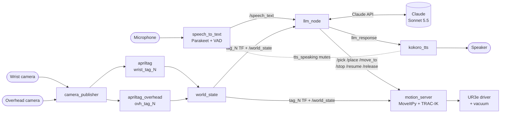

# Colman — Collaborative Manipulation

[](https://github.com/MRRP-lab/colman/actions/workflows/ci.yml)


A voice-controlled **UR3e** robot arm that stacks cubes. You talk to it, a language model
(Claude Sonnet 5.5) decides what you meant, and the arm picks up and places tagged cubes
while two cameras watch the table. Speech recognition and speech synthesis run locally;
only the language model needs the network.

> "Stack the white cubes." — "Putting the white cubes in a stack now." *(the arm moves)* —
> "Done, the white stack is four high."

**Contents**

1. [Overview](#1-overview)
2. [Architecture](#2-architecture)
3. [Hardware](#3-hardware)
4. [Installation](#4-installation)
5. [Quick start](#5-quick-start)
6. [Task reference](#6-task-reference)
7. [Packages](#7-packages)
8. [ROS interfaces](#8-ros-interfaces)
9. [The language model and its tools](#9-the-language-model-and-its-tools)
10. [Perception and the cubes](#10-perception-and-the-cubes)
11. [Camera calibration](#11-camera-calibration)
12. [What the arm can reach](#12-what-the-arm-can-reach)
13. [Safety](#13-safety)
14. [Testing and CI](#14-testing-and-ci)
15. [Configuration reference](#15-configuration-reference)
16. [Troubleshooting](#16-troubleshooting)
17. [Repository layout](#17-repository-layout)
18. [Documentation index](#18-documentation-index)
19. [Contributing](#19-contributing)
20. [Status, limitations and license](#20-status-limitations-and-license)

---

## 1. Overview

Colman is a ROS 2 Jazzy workspace for a simulated or real UR3e with a vacuum gripper, built
around one demo: **voice-controlled cube stacking**.

| Capability | How it works |
| --- | --- |
| **Speech in** | NVIDIA Parakeet TDT 0.6B through `onnx-asr`, with `silero-vad`. Local, no API key. Mutes the microphone while the robot talks. |
| **Understanding** | Claude Sonnet 5.5 with a fixed set of validated tools. It never talks to ROS and never supplies a coordinate or a topic name. |
| **Speech out** | Kokoro-82M, local, default voice `bm_fable` (British). |
| **Seeing** | Two OAK-D Pro cameras (one on the wrist, one fixed 1.8 m overhead) feed AprilTag detectors. A `world_state` node fuses them into "which cube is on which". |
| **Moving** | MoveItPy with TRAC-IK, a one-goal-at-a-time action server, and a vacuum gripper. |
| **Recovering** | A driver supervisor restarts the UR driver and recovers the arm without restarting the rest of the stack. |
| **Simulating** | Gazebo worlds, a mock-hardware UR driver, and a dry-run mode for the LLM node. |

The arm handles eight 50 mm cubes: four white (tags 1–4) and four blue (tags 5–8). Any cube
can be placed on any other, in any order and any colour mix.

## 2. Architecture



Each box is its own ROS 2 node or process. The important rules:

- **The node is the safety boundary.** Claude chooses among tools whose arguments are
  enumerations. The executor re-validates every value, checks the move against the camera's
  view of the table, and checks the arm can reach it, before any goal is sent.
- **The camera is the only source of truth for the cubes.** Nothing remembers a move the arm
  made; a cube is on a stack only if `/world_state` says so, so moving a cube by hand is
  seen.
- **One goal at a time.** The motion server rejects a goal while busy or stopped, and a
  spoken stop bypasses the queue.

## 3. Hardware

| Item | Notes |
| --- | --- |
| Robot | Universal Robots UR3e, controlled over RTDE. Default IP in the tasks is `192.168.56.101`. |
| Gripper | Vacuum nozzle driven from the UR's I/O (`/io_and_status_controller/set_io`), supplied by a Coval LEM series pump ([documentation](https://doc.coval.com/g/LEM/doc/lem_doc_coval_2022_v06_us.pdf), [operating instructions](https://doc.coval.com/g/LEM/not/lem_notice_coval_v7a_2023_01.pdf)). A Robotiq 2F-85 and a custom gripper are also supported in simulation. |
| Cameras | Two Luxonis OAK-D Pro. Which is which is set by serial number in `colman_perception/config/cameras.yaml` (`ros2 run colman_perception list_cameras`). The wrist camera is on the tool flange; the overhead camera is fixed about 1.83 m above the table. |
| Cubes | Eight cubes, exactly 50 mm on each side. Each has an AprilTag (family `36h11`, IDs 1–8) on its top face whose black square is 39.2 mm. |
| Table | Surface at `base_link` z = −0.005 m. |
| Audio | A USB microphone (the stack's launch file finds a TONOR USB mic by name; change it with `mic:=`) and any speaker. |
| Computer | Linux x86-64, glibc ≥ 2.39, kernel ≥ 6.8. A CUDA GPU is optional and speeds up Parakeet. |

Everything except the physical arm can be run without hardware: see
[Quick start](#5-quick-start).

## 4. Installation

Requirements: Linux x86-64, [pixi](https://pixi.sh), and `git-lfs`. pixi installs ROS 2
Jazzy (RoboStack), MoveIt, Gazebo, TRAC-IK, the UR driver, and the Python dependencies.

```bash
curl -fsSL https://pixi.sh/install.sh | sh        # once
git clone git@github.com:MRRP-lab/colman.git
cd colman
git lfs pull
pixi run build                                     # colcon build --symlink-install
```

The first build downloads a large environment (roughly 15 GB installed, including
torch/CUDA wheels). Model weights for Parakeet and Kokoro download on first run, so the first
start needs network access.

**API key.** The LLM node needs `ANTHROPIC_API_KEY`, from your environment or from a `.env`
file in the repository root (gitignored). It exits at startup without it.

```bash
echo 'ANTHROPIC_API_KEY=sk-ant-...' >> .env
```

## 5. Quick start

All commands run from the repository root. See every task with `pixi task list`.

### Simulation

```bash
pixi run sim                 # Gazebo + MoveIt + the simulated UR3e
pixi run sim-depth           # ... with the depth camera
pixi run sim-yolo            # ... with YOLO object detection
```

### Voice and LLM only, no arm

Talk to the robot with the microphone and speaker. `dry_run` gives canned tool results and
moves nothing:

```bash
pixi run stack-dry
```

Without a microphone, publish text instead (`pixi run speak` must be running to hear the
reply):

```bash
ros2 topic pub --once /speech_text std_msgs/msg/String "{data: 'stack the white cubes'}"
```

`stack-dry` starts the cameras, detectors, `world_state` and motion server too, so it needs
the cameras. To run just the three voice nodes:

```bash
pixi run bash -c 'trap "kill 0" EXIT; ros2 run colman_audio_output kokoro_tts & ros2 run colman_llm llm_node --ros-args -p dry_run:=true & ros2 run colman_audio_input speech_to_text'
```

### The real arm

```bash
pixi run stack               # driver, cameras, detectors, world_state, motion, voice, LLM
```

Stay at the robot with the pendant's emergency stop in hand. If the stack is hard to start in one go,
run the pieces in separate terminals, in this order: `pixi run driver`, `pixi run motion`,
`pixi run detect`, `pixi run overhead`, `pixi run speak`, then
`ros2 run colman_audio_input speech_to_text` and `pixi run llm`. Only one driver may hold the
robot: a second fails with `speed_slider_mask is currently controlled by another RTDE
client`.

Manual control, without the LLM:

```bash
ros2 action send_goal --feedback /pick  colman_interfaces/action/Pick  "{frame: tag_1}"
ros2 action send_goal --feedback /place colman_interfaces/action/Place "{location: tag_2}"
pixi run stop      # halt the arm and reject goals
pixi run resume    # accept goals again
```

A successful pick leaves the cube held; the next pick is refused until it is placed or
released (`ros2 service call /release std_srvs/srv/Trigger`).

## 6. Task reference

Every command above is a pixi task defined in [`pixi.toml`](pixi.toml).

| Group | Task | What it does |
| --- | --- | --- |
| **Build** | `build` | `colcon build --symlink-install --base-paths src` |
| | `clean` | Remove `build/`, `install/` and `log/` |
| **Simulation** | `sim`, `sim-depth`, `sim-yolo` | Gazebo with the UR3e, optionally with depth or YOLO |
| | `sim-apriltag-20-panel` | Gazebo with a 20-tag panel world |
| | `mock` | UR driver with mock hardware (no robot) |
| **Real arm** | `stack` | Whole voice-controlled pipeline |
| | `stack-dry` | Same without the arm driver, with `dry_run:=true` |
| | `driver` | Driver supervisor that recovers the UR arm in place |
| | `motion` | Motion server: `/move_to`, `/move_pose`, `/pick`, `/place` |
| | `stop`, `resume` | Call `/stop` and `/resume` |
| **Perception** | `detect` | `camera_publisher`, `world_state` and the wrist AprilTag detector |
| | `overhead` | Overhead camera, its transform and its AprilTag detector |
| | `image-view`, `graph` | `rqt_image_view`, `rqt_graph` |
| **Voice** | `speak` | Kokoro text-to-speech node |
| | `llm` | LLM node |
| **Demos** | `demo`, `demo-turns`, `demo-choose`, `demo-circle`, `demo-obstacle` | Standalone motion demonstrations |
| **Calibration** | `record-wrist-hand-eye-samples`, `solve-wrist-mount-from-hand-eye-samples`, `capture-wrist-table-edge-views`, `capture-wrist-views-of-touched-circles`, `score-wrist-mounts-against-touched-circles`, `check-overhead-pose-against-touched-points` | See [`camera_pose_calibration/README.md`](camera_pose_calibration/README.md) |
| **Testing** | `test-integration` | Motion-level integration test against mock hardware |
| | `hil-check`, `test-hil` | Hardware-in-the-loop runner and its unit tests |
| **Code style** | `fmt`, `lint` | `ruff format` and `ruff check --fix` on `src/` and `scripts/` |
| **Inspection** | `node-list`, `topic-list`, `gz-list` | `ros2 node list`, `ros2 topic list`, `gz topic -l` |

## 7. Packages

| Package | Purpose |
| --- | --- |
| `colman_audio_input` | Parakeet speech-to-text node; mutes while the robot speaks. |
| `colman_audio_output` | Kokoro-82M text-to-speech node. |
| `colman_llm` | The LLM node: Claude client, tool allow-lists, executor, world view. |
| `colman_motion` | MoveItPy motion server, arm and vacuum control, planning-scene boxes for stacks, demos and calibration capture tools. |
| `colman_perception` | Camera publisher, AprilTag post-processing, `world_state`, the overhead height correction, and the calibration fitting tools. |
| `colman_interfaces` | `MoveTo`, `MovePose`, `Pick`, `Place` actions and the `WorldState` / `WorldStack` messages. |
| `colman_bringup` | Launch files (`colman`, `stack`, `apriltag`, `overhead`, …) and the UR driver supervisor. |
| `colman_description` | URDF/Xacro, the arm's factory kinematics, and `workcell.py` (cube, tag and table sizes, defined once). |
| `colman_moveit_config` | MoveIt configuration, joint limits and the SRDF. |
| `colman_gazebo` | Gazebo worlds and models (cubes, table, tag panels). |
| `gripper_description`, `gripper_gazebo` | Custom gripper model and simulation. |
| `oakd_description`, `oakd_gazebo` | OAK-D camera model and simulation. |

## 8. ROS interfaces

**Actions** (served by `motion_server`, one goal at a time)

| Action | Goal | Notes |
| --- | --- | --- |
| `/move_to` (`MoveTo`) | `pose_name` | Named pose from the SRDF (`home`, `Compact`, …). |
| `/move_pose` (`MovePose`) | `pose`, `slow` | A Cartesian target. Not exposed to the LLM. |
| `/pick` (`Pick`) | `frame` (e.g. `tag_3`), optional `place_location` | Waits up to 4 s for the fused tag pose. If `place_location` is set, refuses before moving when it could not place there. Leaves the cube held. |
| `/place` (`Place`) | `location` frame, or `position` | Drops one cube height above the tag, square with the cube below. |

**Services** (`std_srvs/Trigger`): `/stop`, `/resume` (the arm), `/grasp`, `/release`
(the vacuum), `/oakd_pro/refocus`.

**Topics**

| Topic | Type | From → to |
| --- | --- | --- |
| `/speech_text` | `std_msgs/String` | `speech_to_text` → `llm_node` |
| `llm_response` | `std_msgs/String` | `llm_node` → `kokoro_tts` |
| `tts_speaking` | `std_msgs/Bool` (transient local) | `kokoro_tts` → `speech_to_text` (mute) |
| `/world_state` | `colman_interfaces/WorldState` | `world_state` → `llm_node`, `motion_server` |
| `/oakd_pro/*`, `/overhead/*` | images, camera info | `camera_publisher` → detectors |
| `/joint_states` | `sensor_msgs/JointState` | UR driver |

**TF frames**: `tag_N` (the fused pose of cube N, used for picking), `wrist_tag_N` and
`ovh_tag_N` (each camera's own detection), and `overhead_camera_optical_frame`.

## 9. The language model and its tools

`colman_llm` sends each utterance to Claude Sonnet 5.5 (`claude-sonnet-5-5`) with a short
static system prompt. The live list of cubes is appended from the allow-lists so the two
never drift apart.

| Tool | Arguments | What it does |
| --- | --- | --- |
| `stack_cube` | `color` (`white`/`blue`), `count` (2–4) | Builds a stack of `count` cubes of that colour on the tallest stack of that colour. No cube is a base. |
| `pick_and_place` | `object`, `destination` (any of the 8 cubes) | Moves one free cube onto another free cube, in any colour. |
| `go_to_pose` | `pose` (`home`, `compact`) | Moves the empty arm to a named pose. |
| `release_cube` | none | Vacuum off, where the cube is. |
| `report_state` | none | Describes stacks, loose cubes, the gripper, and whether the arm is stopped. |
| `stop_robot`, `resume_robot` | none | `/stop` and `/resume`. |

Cubes are named `white cube 1`–`4` and `blue cube 5`–`8`, matching their tag numbers.

How it behaves:

- **Staying quiet.** The microphone hears a busy room, so Claude answers the single word
  `IGNORE` to anything not clearly about the arm or the cubes, and the node says nothing.
- **Saying what it is doing.** Before a tool that moves the arm, Claude says one short
  sentence in its own words. The node speaks it immediately, while the arm works. There is
  no fixed "on it".
- **Checking before moving.** The executor refuses a move the camera contradicts (a cube
  that is covered, already placed, or not visible) with a plain reason Claude relays. It
  also tells the motion server where the picked cube will go (`place_location` on the
  `Pick` goal), and the server solves that place with the real MoveIt IK and collision
  checks *before* it picks, so the arm is never left holding a cube it cannot put down.
- **Stopping.** Saying "stop", "halt", "freeze", "cancel", "abort", "hold still", "stay
  still", "don't move" or "that's enough" calls `/stop`, cancels the running goal and drops
  the queue before anything else is processed. The reply is a fixed "Stopped." so it is
  instant. A new move command after a stop also clears it.
- **Dry run.** `-p dry_run:=true` swaps in a fake arm on a pretend table, so tools work end to
  end without hardware.

The design, the SDK settings that matter, and the reasoning are in
[`docs/plan.md`](docs/plan.md).

## 10. Perception and the cubes

- **Tags.** AprilTag `36h11`, IDs 1–8, black square 39.2 mm, on the top of 50 mm cubes. Two
  detectors run: `apriltag` (wrist, frames `wrist_tag_N`) and `apriltag_overhead`
  (overhead, frames `ovh_tag_N`), each with `decimate: 3.0` and 8 threads.
- **Cameras.** The wrist camera runs at 1080p, 60 fps, uncompressed. The overhead camera runs
  at 4K, 30 fps, MJPEG quality 90, because a tag is only about 63 px wide at 4K from 1.8 m.
  `config/fastdds_shared_memory_large_images.xml` is loaded by every pixi task so large
  images reach other processes reliably.
- **`world_state`.** Fuses both detectors: the wrist pose is used only while the arm is
  still, otherwise the overhead pose. It builds columns of cubes, reads a column's height
  from its top tag, remembers cubes the arm is hiding (and cubes covered by others), drops a
  cube that vanishes for no reason after a timeout, and marks the order uncertain if what it
  sees contradicts what it remembered. If the overhead camera stops, `/world_state` is
  marked stale and the node refuses to move.
- **Overhead height correction.** The overhead detector's depth from tag size reads about 3
  cm low, so `overhead_correction.py` applies a linear fit (and re-projects x and y along the
  camera ray). Refit it whenever the tag size, camera pose or camera exposure changes.
- **Workcell sizes** live in one place, `colman_description/workcell.py`:
  `CUBE_SIZE_M = 0.05`, `TAG_SIZE_M = 0.0392`, `TABLE_TOP_Z = -0.005` and
  `cube_top_z(level)`. Every package imports them, and a test fails if the 39.2 mm tag size
  is used as a cube size.

## 11. Camera calibration

Two fixed transforms are fitted to points the arm's nozzle actually touched:

| Transform | Where it is used | Error against the touched points |
| --- | --- | --- |
| Overhead camera pose in `base_link` | `colman_perception/config/overhead_camera_pose_in_base_link.yaml` | 0.9 mm on held-out points |
| Wrist camera mount on the tool flange | `oakd_pro_joint` in `colman.urdf.xacro` | median 0.8 mm, rms 2.3 mm |

The arm's kinematics are taken as correct and lens intrinsics are the OAK-D's factory values.
The fits are checked at table height only. Data, results, the capture and fitting tools and
how to redo each fit are in [`camera_pose_calibration/`](camera_pose_calibration/README.md).

## 12. What the arm can reach

With the nozzle pointing straight down, the usable area is a ring around the base: roughly
0.16 m to 0.52 m forward of the base at y = 0, narrower for taller stacks, and nothing
beyond about ±0.45 m sideways. A stack of four cubes can be built over about 39% of the
table. The map, the numbers and how they were computed are in
[`docs/arm_reach/`](docs/arm_reach/README.md). The LLM node checks reach before every pick.

## 13. Safety

- A physical emergency stop on the pendant is the real safety mechanism. Voice stop is a
  convenience on top of it.
- The microphone is muted while the robot speaks, so a stop word said over the robot's
  voice is not heard.
- Treat transcription as untrusted: a misheard sentence can only select from the enumerated
  cubes and poses.
- The node refuses to move without a fresh `/world_state`.
- Never give the LLM raw joint positions, Cartesian coordinates, topic or action names.
- The arm and vacuum are not simulated in `stack-dry`: with `driver:=false` there are no
  joint states and nothing moves.

## 14. Testing and CI

| What | How |
| --- | --- |
| Lint and format | `pixi run lint`, `pixi run fmt` (`ruff`, rules `E`, `F`, `I`) |
| Unit tests | `pixi run colcon test --event-handlers console_direct+ --pytest-args -k "not flake8 and not pep257"` |
| Integration test | `pixi run test-integration`: the real motion server and MoveIt against mock UR hardware and fake tags, with no Gazebo or display |
| Hardware in the loop | `pixi run hil-check --dry-run`, then `pixi run hil-check --i-am-at-the-robot --cycles 3`. See [`docs/hil_checklist.md`](docs/hil_checklist.md). Not part of CI. |
| Runner self-test | `pixi run test-hil` |

GitHub Actions (`.github/workflows/ci.yml`) runs on pushes to `main` and on pull requests:
a `lint` job (`ruff format --check` and `ruff check` on `src/`) and a `build` job (build,
the unit tests above, and the integration test). The ament flake8 and pep257 template tests
are skipped because they disagree with `ruff`'s formatting.

## 15. Configuration reference

| Node | Parameter | Default | Meaning |
| --- | --- | --- | --- |
| `stack.launch.py` | `dry_run` | `false` | Passed to `llm_node`; canned tool results, the arm is not moved by the LLM |
| | `driver` | `true` | Start the arm driver supervisor (`false` if one is already running) |
| | `robot_ip` | `192.168.56.101` | The UR's address |
| `llm_node` | `model` | `claude-sonnet-5-5` | Claude model |
| | `pick_timeout_s`, `place_timeout_s`, `move_timeout_s` | 120, 120, 60 | Per-action timeouts; the goal is cancelled on timeout |
| | `dry_run` | `false` | Fake arm, canned results |
| `kokoro_tts` | `voice` | `bm_fable` | Kokoro voice pack |
| | `lang_code` | `b` | `a` American, `b` British |
| | `speed`, `mode`, `output_dir`, `max_queue` | | `mode` is `stream`, `play` or `save` |
| `speech_to_text` | `topic` | `speech_text` | Output topic |
| | `model_name` | `nemo-parakeet-tdt-0.6b-v2` | Parakeet model |
| | `device` | `auto` | `auto`, `cuda` or `cpu` |
| | `silence_ms`, `max_utterance_s`, `vad_threshold` | 700, 30, 0.5 | Voice-activity detection |
| | `mute_topic`, `mute_tail_ms`, `mute_max_s` | `tts_speaking`, 600, 60 | Mute while the robot speaks |
| | `input_device` | empty | sounddevice index or name; `python -m sounddevice` lists them |
| `camera_publisher` | `camera` | `wrist` | A name from `config/cameras.yaml` |
| | `fps`, `jpeg_quality`, `decode_threads` | per camera | Overrides the per-camera table in `camera_publisher.py` |

## 16. Troubleshooting

| Symptom | Likely cause and fix |
| --- | --- |
| A node fails to start with `StopIteration` | Its package is not built. Run `pixi run build`. |
| Duplicate replies | Nodes from an earlier run are still alive. `pkill -f 'llm_node\|kokoro_tts\|speech_to_text'`. |
| `speed_slider_mask is currently controlled by another RTDE client` | A second driver is holding the robot. Stop it. |
| Next pick fails with "Already holding" | A place failed after a pick and the vacuum still holds the cube. `ros2 service call /release std_srvs/srv/Trigger`. |
| The robot says it can't see the table, or won't move | `/world_state` is missing or stale: check `pixi run overhead` is running and the overhead camera is plugged in. |
| The robot says a cube is out of reach | It is outside the reach map. Move the cube nearer the middle of the table. |
| The microphone does nothing or listens to the wrong device | The stack uses input index 10, which shifts if USB audio devices are replugged. List devices with `python -m sounddevice`. |
| Camera images are dropped between processes | The pixi activation sets the Fast DDS shared-memory profile. Run through `pixi run`, not a bare shell. |
| Tag heights look several cm off | Raw `ovh_tag_N` heights read low; use the fused `tag_N`. Check that `overhead_correction.py` still matches the tag size, camera pose and exposure. |
| First start is slow or fails offline | Parakeet and Kokoro download weights on first run. |

## 17. Repository layout

```text
colman/
├── src/                      ROS 2 packages (see section 7)
├── camera_pose_calibration/  fitted camera poses, their data, and how to redo them
├── docs/
│   ├── plan.md               LLM design and decisions
│   ├── repository_summary.md how the repository works, in depth
│   ├── hil_checklist.md      hardware-in-the-loop reliability run
│   ├── arm_reach/            map of what the arm can reach
│   ├── architecture/         pipeline diagram
│   ├── audio/                Kokoro voice demo
│   └── cad/                  mounts for the camera, cables and pneumatics
├── scripts/                  hil_check.py and its tests
├── config/                   Fast DDS profile for large images
├── pixi.toml                 environment and every task
└── .github/workflows/ci.yml  lint, build, unit and integration tests
```

## 18. Documentation index

| Document | Read it for |
| --- | --- |
| [`docs/repository_summary.md`](docs/repository_summary.md) | How the whole repository works, section by section |
| [`docs/plan.md`](docs/plan.md) | The LLM node's design, the tool definitions, safety and testing |
| [`docs/arm_reach/README.md`](docs/arm_reach/README.md) | Where the arm can and cannot reach on the table |
| [`camera_pose_calibration/README.md`](camera_pose_calibration/README.md) | Camera calibration results, data and procedure |
| [`docs/hil_checklist.md`](docs/hil_checklist.md) | Running the real-arm reliability check |
| [`src/colman_audio_input/README.md`](src/colman_audio_input/README.md) | Speech input parameters and device selection |

## 19. Contributing

1. Branch from `main` and open a pull request. CI must pass.
2. Format and lint with `pixi run fmt` and `pixi run lint` before pushing.
3. Add or update tests with the change. `colman_llm`, `colman_perception` and
   `colman_motion` have unit tests; motion behaviour is covered by `pixi run test-integration`.
4. Keep the docs true. If you change a task, a topic, a parameter or a behaviour described
   here or in `docs/`, change the doc in the same pull request.
5. Constants that must agree across packages (cube and tag sizes, joint limits, offsets)
   are defined once or guarded by a test that fails if copies drift. Keep it that way.

## 20. Status, limitations and license

**Status.** The full voice-to-arm pipeline is on `main` and has been run on the real arm.
Known open items:

- **License.** The repository has no `LICENSE` file, and every `package.xml` and `setup.py`
  still says `TODO: License declaration`. Choose one before reusing the code.
- **Overhead exposure.** The overhead camera clips the white tag cells and its raw tag
  depth reads low; the height correction hides this rather than fixing the exposure.
- **Calibration at height.** The camera fits are checked only at table height.
- **Place check.** The motion server checks the place pose before a pick using the cube's
  yaw before it is grasped, so the final squaring turn is not part of the check. It is
  almost always the same answer, but not guaranteed.
- **Architecture diagram.** `docs/architecture/architecture.svg` predates the overhead
  camera and `world_state`.
- **CI scope.** Lint covers `src/` only, and the ament flake8 and pep257 tests are skipped.

**Third-party.** Kokoro-82M (Apache 2.0), NVIDIA Parakeet, Anthropic's Claude API, the
Universal Robots ROS 2 driver, MoveIt 2, TRAC-IK and `apriltag_ros`.
