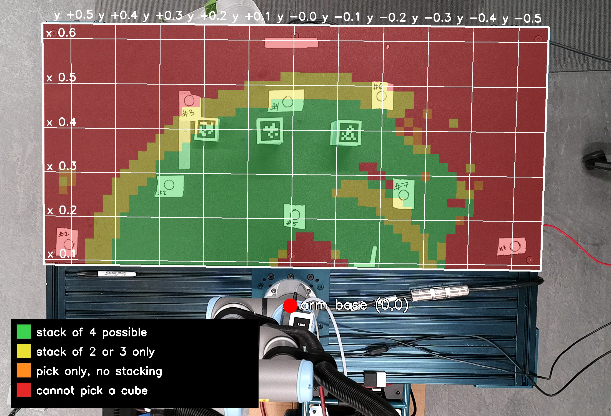

# Where the arm can reach on the table

The picture is an overhead 4K still with the reach drawn on the table plane. The grid is every 10 cm in `base_link`: x is forward from the arm base and y is to the arm's left (left of the picture). Cubes are 50 mm (`workcell.py`; 39.2 mm is the tag's black square), and the table top is at z = -0.005 m.

| Colour | Share of the table | Meaning |
| --- | --- | --- |
| Green | 39% | A stack of 4 cubes can be built here: cubes can be picked up from here, and a cube can be placed on top of a 1-, 2- and 3-cube stack here. |
| Yellow | 9% | A stack of 2 or 3 cubes can be built here, but not 4. |
| Orange | under 1% | A cube can be picked up here, but nothing can be stacked on it. |
| Red | 52% | A cube here cannot be picked up. |

## What it means for stacking

- **The usable area is a ring around the base.** At y = 0 a cube on the table can be picked from x = 0.16 to 0.52 m. A stack of 4 can be built from x = 0.16 to 0.46 m.
- **Sides:** at y = +0.3 a cube can be picked from x = 0.10 to 0.38 m and a 4-stack built from x = 0.10 to 0.32 m. At y = -0.3 the ranges are x = 0.10 to 0.44 m (pick) and 0.10 to 0.38 m (4-stack). Nothing beyond about |y| 0.45 m is reachable.
- **Taller stacks shrink the area.** The share of the table where a stack of N cubes can be built is about 48% for 1, 47% for 2, 43% for 3, 39% for 4, 29% for 5, 20% for 6 and 10% for 7.
- **Not reachable at all:** the far third of the table (x above about 0.52 m), both far side strips, and a patch right in front of the base (x below about 0.16 m near y = 0).
- **Practical rule:** keep cubes within roughly x 0.18 to 0.45 m and y -0.3 to +0.3 m, and build tall stacks near the middle of that.

## How it was computed

- **Arm:** the URDF chain from `base_link` to `vacuum_tip_link` with the factory kinematics in `ur_config.yaml` and the joint limits in `colman_moveit_config/config/joint_limits.yaml` as on `main` after #44.
- **Poses:** the nozzle points straight down (`EE_DOWN`, quaternion (1, 0, 0, 0)). A pick is feasible if the grab pose (tag z - 0.01 m) and the approach pose (tag z + 0.10 m) both have an IK solution on the same branch. A place onto a stack is feasible if the drop pose (top tag z + 0.05 m) and the approach 0.05 m above it do. A cube at level n has its tag at z = -0.005 + 0.05 n. A numerical 6D solver was run on a 2 cm grid from 20 starting joint configurations per point (position within 1 mm, orientation within 0.01 rad). The first pass missed some reachable points, so every cell that was not green inside the working ring (0.16 to 0.50 m from the base) was solved again from 120 starting configurations; 70 of 208 turned green. Cells outside that ring, and the yellow and red cells that remain, were not re-solved with more seeds, so a few isolated cells near the outer edge may still be wrong. The blockiness comes from the 2 cm cells.
- **Projection:** the overhead pose in `camera_pose_calibration/results/overhead_camera_pose_in_base_link.yaml` with the 4K intrinsics from `overhead_capture.npz`.
- **Still:** `colman_calibration_archive/overhead_4k_capture/overhead_rgb.png`.

## What this does not include

- It is kinematics only. MoveIt collision checks, the table and the held cube's planning box, the wrist camera's view and motion-planner failures are not modelled, so the real usable area can be smaller.
- The solver is not TRAC-IK, so points near an edge may flip either way. Treat the outlines as +-2 to 3 cm.
- This replaces an earlier version of this map that wrongly used 39.2 mm cubes.

## Where the node uses it

`colman_llm/reach.py` is a numpy model of the same arm that the LLM node asks before it picks anything up: can the arm pick this cube, and can it place on the top of that stack? It uses the same joint chain, joint limits, tool tip and quarter turns as above and refuses anything within 0.16 m of the base, which matches the near edge of this map. At the far edge it is within about 2 cm of the map. See the Cube stacking demo section of [`../plan.md`](../plan.md).
